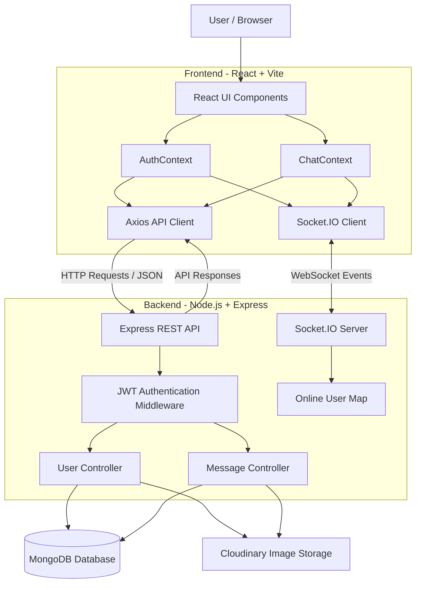

# 💬 QuickChat – Real-Time Full-Stack Chat Application

QuickChat is a real-time, full-stack messaging application built using **React, Node.js, Express.js, MongoDB, and Socket.IO**. It enables users to communicate seamlessly through instant messaging, share images, manage profiles, and view online/offline status.

The application uses REST APIs for backend communication and Socket.IO for real-time message delivery, providing a smooth and responsive chatting experience.

## 🚀 Features

- **User Authentication:** Secure signup and login using JWT authentication.
- **Password Encryption:** Password hashing using bcryptjs.
- **Real-Time Messaging:** Instant message delivery using Socket.IO.
- **Online Status:** Displays users who are currently online.
- **One-to-One Chat:** Private conversations between users.
- **Image Sharing:** Upload and share images using Cloudinary.
- **User Profiles:** Update profile picture, name, and bio.
- **Unread Messages:** Tracks unread messages and message status.
- **Message History:** Retrieves previous conversations from MongoDB.
- **Responsive UI:** User-friendly interface built with React and Tailwind CSS.
- **Toast Notifications:** Provides feedback for user actions.

## 🛠️ Tech Stack

| Category | Technologies |
|---|---|
| Frontend | React.js, Vite |
| Styling | Tailwind CSS |
| Backend | Node.js, Express.js |
| Database | MongoDB |
| ODM | Mongoose |
| Real-Time Communication | Socket.IO |
| Authentication | JWT, bcryptjs |
| API Communication | Axios |
| Image Storage | Cloudinary |
| Routing | React Router |
| Notifications | React Hot Toast |

## 🏗️ System Architecture

QuickChat follows a **Client–Server Architecture** consisting of a React frontend, Express backend, MongoDB database, and Socket.IO real-time communication layer.

### Architecture Diagram



### Architecture Explanation

**1. Frontend Layer**
- Developed using React.js and Vite.
- React Context API manages authentication and chat state.
- Axios sends HTTP requests to the backend.
- Socket.IO Client establishes a persistent connection for real-time communication.

**2. Backend Layer**
- Node.js and Express.js handle API requests.
- JWT middleware protects authenticated routes.
- Controllers implement authentication, user management, and messaging logic.
- Socket.IO manages real-time communication and online-user tracking.

**3. Database Layer**
- MongoDB stores user information and chat messages.
- Mongoose manages database schemas and operations.

**4. Cloud Storage**
- Cloudinary stores uploaded profile pictures and chat images.
- The application stores the resulting image URLs in MongoDB.

## 🔄 Application Workflow

### 1. User Authentication

1. User registers or logs in through the React frontend.
2. Axios sends credentials to the Express backend.
3. Backend validates user information.
4. Passwords are hashed using bcryptjs during registration.
5. JWT is generated after successful authentication.
6. Frontend stores the authentication token in localStorage.
7. Protected API requests include the token in the request header.

### 2. Real-Time Messaging

1. Sender selects a user from the chat list.
2. Sender enters a message or selects an image.
3. Frontend sends the message to the backend using Axios.
4. Backend identifies the sender using JWT authentication.
5. Image uploads are handled through Cloudinary when applicable.
6. Message details are stored in MongoDB.
7. Backend identifies the receiver's active socket connection.
8. Socket.IO emits a `newMessage` event to the receiver.
9. Receiver's interface updates immediately without refreshing the page.

### 3. Online User Tracking

1. When a user connects, the frontend establishes a Socket.IO connection.
2. The server associates the user ID with the socket ID.
3. Connected users are maintained in an in-memory map.
4. The server broadcasts online users through `getOnlineUsers`.
5. When a user disconnects, the corresponding socket mapping is removed.

## 📁 Project Structure

```text
QuickChat/
│
├── client/
│   ├── context/
│   │   ├── AuthContext.jsx
│   │   └── ChatContext.jsx
│   │
│   ├── public/
│   │
│   ├── src/
│   │   ├── components/
│   │   │   ├── ChatContainer.jsx
│   │   │   ├── Sidebar.jsx
│   │   │   └── RightSidebar.jsx
│   │   │
│   │   ├── pages/
│   │   │   ├── HomePage.jsx
│   │   │   ├── LoginPage.jsx
│   │   │   └── ProfilePage.jsx
│   │   │
│   │   ├── assets/
│   │   ├── lib/
│   │   ├── App.jsx
│   │   ├── index.css
│   │   └── main.jsx
│   │
│   ├── .env
│   └── package.json
│
└── server/
    ├── controllers/
    │   ├── userController.js
    │   └── messageController.js
    │
    ├── middleware/
    │   └── auth.js
    │
    ├── models/
    │   ├── User.js
    │   └── Message.js
    │
    ├── routes/
    │   ├── userRoutes.js
    │   └── messageRoutes.js
    │
    ├── lib/
    │   ├── db.js
    │   ├── cloudinary.js
    │   └── utils.js
    │
    ├── server.js
    ├── .env
    └── package.json
```

## 🗄️ Database Design

The application uses MongoDB with Mongoose for data management.

### User Collection

| Field | Type | Description |
|---|---|---|
| fullName | String | User's full name |
| email | String | Unique email address |
| password | String | Hashed password |
| profilePic | String | Profile image URL |
| bio | String | User biography |

### Message Collection

| Field | Type | Description |
|---|---|---|
| senderId | ObjectId | Sender's user ID |
| receiverId | ObjectId | Receiver's user ID |
| text | String | Message content |
| image | String | Image URL |
| seen | Boolean | Message read status |

## 🔌 API Documentation

### Authentication APIs

Base URL: `/api/auth`

| Method | Endpoint | Description |
|---|---|---|
| POST | `/signup` | Register a new user |
| POST | `/login` | Authenticate a user |
| GET | `/check` | Verify authentication |
| PUT | `/update-profile` | Update user profile |

### Messaging APIs

Base URL: `/api/messages`

| Method | Endpoint | Description |
|---|---|---|
| GET | `/users` | Retrieve users and unread counts |
| GET | `/:id` | Retrieve conversation history |
| POST | `/send/:id` | Send a message |
| PUT | `/mark/:id` | Mark a message as seen |

### Socket.IO Events

| Event | Direction | Description |
|---|---|---|
| `getOnlineUsers` | Server → Client | Updates online users |
| `newMessage` | Server → Receiver | Delivers new messages |

## ⚙️ Installation and Setup

### Prerequisites

Make sure you have installed:

- Node.js
- npm
- MongoDB account or local MongoDB server
- Cloudinary account
- Git

### 1. Clone the Repository

```bash
git clone https://github.com/your-username/your-repository.git
cd QuickChat
```

### 2. Setup Backend

```bash
cd server
npm install
```

Create a `.env` file inside the server folder.

```env
PORT=5000
NODE_ENV=development

MONGODB_URI=your_mongodb_connection_string
JWT_SECRET=your_jwt_secret

CLOUDINARY_CLOUD_NAME=your_cloud_name
CLOUDINARY_API_KEY=your_api_key
CLOUDINARY_API_SECRET=your_api_secret
```

Start the backend:

```bash
npm run server
```

Backend runs at:

```text
http://localhost:5000
```

### 3. Setup Frontend

Open another terminal:

```bash
cd client
npm install
```

Create a `.env` file inside the client folder.

```env
VITE_BACKEND_URL=http://localhost:5000
```

Start the frontend:

```bash
npm run dev
```

Open the URL provided by Vite, usually:

```text
http://localhost:5173
```

### 4. Build for Production

```bash
cd client
npm run build
```

## 🔐 Environment Variables

| Variable | Description |
|---|---|
| PORT | Backend server port |
| NODE_ENV | Application environment |
| MONGODB_URI | MongoDB connection string |
| JWT_SECRET | JWT signing secret |
| CLOUDINARY_CLOUD_NAME | Cloudinary cloud name |
| CLOUDINARY_API_KEY | Cloudinary API key |
| CLOUDINARY_API_SECRET | Cloudinary API secret |
| VITE_BACKEND_URL | Backend URL used by frontend |

**Security Note:** Never upload `.env` files, API keys, database credentials, or JWT secrets to a public GitHub repository.

## 🧠 State Management

The application uses React Context API to manage global application state.

**AuthContext**
- Manages user authentication.
- Stores the current user information.
- Configures Axios authentication headers.
- Establishes Socket.IO connections.
- Maintains online-user information.

**ChatContext**
- Manages the list of users.
- Maintains the selected conversation.
- Retrieves and stores messages.
- Handles message sending.
- Tracks unread messages.
- Listens for real-time message events.

## 🚀 Future Enhancements

- Group chat functionality.
- Typing indicators.
- Message editing and deletion.
- Push notifications.
- Message search functionality.
- Last-seen timestamps.
- Message delivery and read receipts.
- Improved security and rate limiting.
- Automated frontend and backend testing.

## 🎯 Key Learning Outcomes

Through this project, I gained practical experience in:

- Full-stack web application development.
- REST API development using Express.js.
- Real-time communication using Socket.IO.
- JWT authentication and password hashing.
- MongoDB database design and integration.
- React Context API for state management.
- Cloudinary integration for image uploads.
- Client-server architecture and API integration.

## 👨‍💻 Author

**Tumati Yaswanth Gokul**

B.Tech Student | Full-Stack Developer | Software Development Enthusiast

---

⭐ If you find this project interesting, consider giving it a star!
